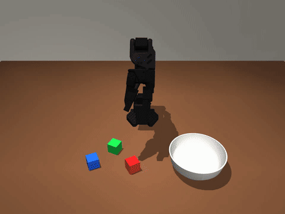

# Pip: talk to an SO-101 robot arm, full duplex

[](docs/demo.mp4)

**[Watch the full demo with sound (docs/demo.mp4)](docs/demo.mp4).** Live take, real voice, captions are Pip's own words.

You talk to **PersonaPlex** (NVIDIA's full-duplex speech-to-speech model, 7B). It answers in its own voice, and what
it *says* it is doing is what the arm does, starting mid-sentence. On top of the words, a probe reads PersonaPlex's
**hidden state** every 80 ms and acts on what you asked for before it has said anything. Built in a 3-hour hackathon
on a MuJoCo sim of the SO-101 with a system-identified servo model (sim-to-real env below).

```
mic --> PersonaPlex (GPU) --> voice
           |  text stream (its own words)          |  hidden state (4096-d, 12.5 Hz)
           v                                        v
     hack/intent.py  streaming parser        server-side linear probe (deploy/patch_probe_stream.py)
           \________________ intents ________________/
                           v
     hack/skills.py   pick / place / point / nudge / wave / clean up / tower / line up / stop -- all interruptible
     hack/action_model  learned goal-conditioned reacher (PPO, sim-to-real randomisation, numpy inference)
     hack/scene.py      calibrated SO-101 sim + 3 cubes + bowl  (--real mirrors it onto the arm)
     hack/app.py        30 Hz control loop + web UI (live view, captions, hidden-state bars)
```

## Results (measured today)

| | |
|---|---|
| Word -> arm motion inside the app | ~25 ms (one control tick) |
| "Stop!" | lands as the user finishes saying it (full duplex: PersonaPlex hears you while it talks) |
| Hidden-state probe, 10 held-out sessions | 43/66 commands, 0 fires on chit-chat, **~0.4 s ahead of the words**; also catches commands PersonaPlex never says aloud |
| Grasps (36 picks, 12 random layouts, randomised servos/latency) | learned reacher 32/36, IK fallback 34/36 |
| Multi-step jobs | clean up the table 8/8, build a tower 8/8, line them up 7/8 |
| SmolVLA distilled from the sim expert (pixels only) | 2/20 -- learns the motion, not *which* cube; grounding is the next step |

## Run it

```
python -m hack.app --model rl --hidden --server-probe   # PersonaPlex at ws://127.0.0.1:8998/api/chat (ssh tunnel), UI on :8080
python -m hack.app --no-voice                            # sim + UI only; type what Pip would say
python -m hack.sim_script --model rl --video x.mp4      # headless scripted conversation
```
Server side: PersonaPlex (`NVIDIA/personaplex`) + `deploy/patch_hidden_stream.py` + `deploy/patch_probe_stream.py`
(streams 13 probe probabilities per frame instead of the 8 KB hidden state, so it works over slow tunnels).

---

# so101-sim2real

A MuJoCo + Gymnasium environment for the owner's SO-101 follower arm. It is built so a policy trained in the sim
runs unchanged on the bench, and so the sim-to-real gap is **measured**, not assumed.

```
pip install -e .            # or: uv venv && uv pip install -e ".[dev]"
python -m pytest -q tests   # 13 tests, ~30 s
```

```python
from so101_sim2real.env import SO101Env, DRConfig
env = SO101Env("lift", obs_keys=("joints", "prev_goal", "wrist"))   # or "reach" with "target"
obs, info = env.reset(seed=0)
obs, reward, terminated, truncated, info = env.step(env.action_space.sample())
info["privileged"]   # true joints, cube pose, calibration error, latency: for teachers / asymmetric critics only
```

The real twin has the same spaces and action mapping:

```python
from so101_sim2real.real import SO101RealEnv          # needs the LeRobot 0.6.1 venv
env = SO101RealEnv("reach", obs_keys=("joints", "prev_goal", "target"), allow_motion=True)
```

## What makes it transfer

| Gap | What the env does |
|---|---|
| Units and zeros | Policy I/O is LeRobot `so_follower` degrees (owner calibration) + gripper 0..100; the sim maps to model radians through bench-fitted offsets (`assets/calibration.json`). |
| Servo dynamics | STS3215 model: PD inside a torque clip, back-EMF speed limit, Coulomb friction, rotor inertia, command latency, gripper overload cut-off. Native MuJoCo actuators, so it is fast (~540 state steps/s on one core). |
| Servo parameters | **Fitted to recordings of the real arm** (`sysid/`), randomised along the fit's own posterior covariance. |
| Loop timing | Observation read at the tick, goal written after a compute delay, servo acts after bus latency, period jitter. |
| Goal clamping | LeRobot's `max_relative_target` (around the measured pose) in both sim and real, default 10 deg. |
| Encoders | Present_Position quantised to 4096 ticks, with noise. |
| Calibration error | Owner-to-model joint offsets were fitted from images, never measured; each episode perturbs them (lift/elbow +-2.5 deg). |
| Wrist camera | Bench-fitted mount and FOV, jittered; exposure, white balance, gamma, blur, sensor noise, JPEG; one shared letterbox transform (`contract.preprocess_image`) for sim and real. |
| Scene | Procedural wood tops, sticker cube, cube mass/friction/size, link masses, lights, table tilt, optional distractor bowl. |

## System identification (do this before trusting transfer)

Until `so101_sim2real/assets/fitted.json` exists, the env warns and uses the vendor servo model with x2
randomisation. To fit the real arm (owner at the arm, ~4 min per recording):

```
PY=C:/Users/sarta/reachy-duplex/.venv-so101/Scripts/python.exe     # has lerobot
$PY -m so101_sim2real.sysid.record --out runs/rec_A.npz --seed 1                                  # dry run, sim safety check
$PY -m so101_sim2real.sysid.record --out runs/rec_A.npz --seed 1 --i-am-at-the-arm --scale 0.5   # first, half amplitude
$PY -m so101_sim2real.sysid.record --out runs/rec_A.npz --seed 1 --i-am-at-the-arm
$PY -m so101_sim2real.sysid.record --out runs/rec_B.npz --seed 2 --i-am-at-the-arm               # held-out run
python -m so101_sim2real.sysid.fit runs/rec_A.npz --holdout runs/rec_B.npz                       # writes assets/fitted.json
```

The recorder moves to a hold pose at 15 deg/s, excites one joint at a time (steps 2-25 deg, a 0.3-4 Hz chirp,
constant-speed ramps, gravity holds), sends goals at 30 Hz and reads positions as fast as the bus allows. Every
program is checked in the sim first (gripper >= 30 mm above the table with 4 deg overshoot). Abort: create
`runs/STOP` or Ctrl-C; the arm holds its measured pose with torque on. It never drops torque.

The fit prints a held-out table: per-joint error of the fitted model, the vendor prior, and "ideal tracking"
(the joint is where the goal says). The gate is fitted <= 0.5 x ideal on every joint.

**Synthetic check (no hardware):** a fake arm with parameters 10-30x off the prior, recorded through the same
pipeline, fitted, and scored on a second recording:

| joint | fitted | prior | ideal tracking |
|---|---|---|---|
| shoulder_pan | 0.064 deg | 1.44 | 3.78 |
| shoulder_lift | 0.075 | 1.97 | 4.09 |
| elbow_flex | 0.095 | 1.30 | 3.86 |
| wrist_flex | 0.076 | 1.07 | 3.66 |
| wrist_roll | 0.087 | 0.92 | 3.58 |
| gripper | 0.103 units | 1.79 | 12.17 |

Gravity-loaded joints recover their parameters within ~20 %. On unloaded joints (pan, roll, gripper) kp, kv, tau
and armature are only identified jointly; the randomisation samples along that correlation.

## Known limits

- **Joint zeros are the biggest remaining gap.** A non-adaptive reach controller (`examples/scripted_reach.py`)
  hits 0.2 mm with randomisation off and 15/20 within 15 mm (median 10, p90 41 mm) with it on; almost all of the
  difference is the calibration-error randomisation. Measuring the lift/elbow zeros on the bench would shrink it.
- Gear backlash (~+-0.5 deg) and the firmware dead band are not modelled; they show up as fit residual on real data.
- Gripper overload protection uses datasheet behaviour (25 % after 2 s at the limit), not a measurement.
- The front camera is not calibrated to any real mount; only the wrist camera is.
- Shoulder-pan sign is taken from the official model, not verified on the bench.

## Provenance

Scene, meshes and wrist-camera calibration are vendored from `reachy-duplex/sim/so101/v3` (built 2026-09-19 from
TheRobotStudio SO-101 `so101_new_calib.xml`, Apache-2.0, see `assets/so101_official/LICENSE`).
